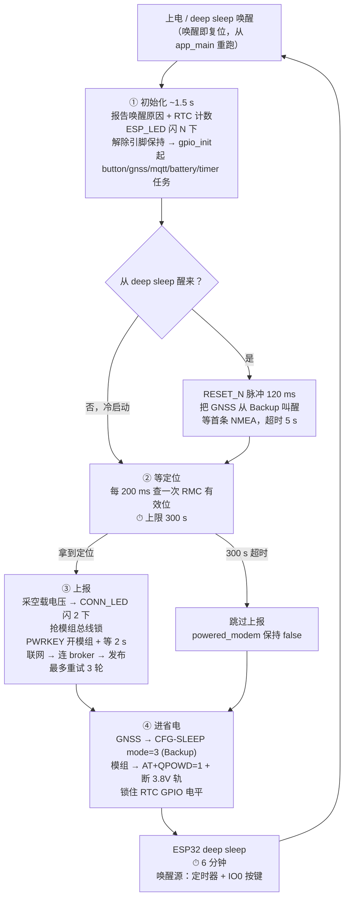

# 业务流程（SELFTEST=0）

当前实现 = 方案 E：GNSS Backup + 模组关机 + ESP32 deep sleep。

---

## 一轮的时间轴

---

## 各阶段的硬件状态

| 阶段 | ESP32 | GNSS LC760Z | EG800 模组 | 3.8V 轨 |
|---|---|---|---|---|
| ① 初始化 | 全速 | 刚被 RESET_N 唤醒 | 关 | **通电**（IO48=0） |
| ② 等定位（≤300 s） | 全速 | **搜星 ~36 mA** | 关 | **通电但空载** ← 可优化 |
| ③ 上报（~60 s） | 全速 | 跟踪 | **开机、注网、发布** | 通电有载 |
| ④ 深睡 | deep sleep | **Backup**（VCC 保持，靠 IO11 上拉电阻） | 已 QPOWD 关机 | 断开（IO48 板上下拉） |

深睡整机实测 **112 µA**，见 `POWER_BUDGET.md` 1.1 节。

②③两阶段 3.8V 轨的状态见 `POWER_BUDGET.md` 4.1 节。

---

## 所有超时常量

| 宏 | 值 | 作用 |
|---|---:|---|
| `GPS_FIX_TIMEOUT_SEC` | **300 s** | **搜星上限，超时即放弃本轮上报** |
| `GPS_CYCLE_SLEEP_MIN` | 6 min | deep sleep 时长 |
| `GNSS_WAKE_TIMEOUT_MS` | 5000 ms | RESET_N 唤醒后等首条 NMEA |
| `GNSS_SLEEP_ACK_TIMEOUT_MS` | 500 ms | CFG-SLEEP 的 ACK（本就不回，等一下即可） |
| `GNSS_QBIN_ACK_TIMEOUT_MS` | 1500 ms | 其余二进制命令的 ACK |
| `MODEM_QPOWD_TIMEOUT_MS` | 15000 ms | 等 `POWERED DOWN` |
| `MQTT_SEND_MAX_RETRY` | 3 | 上报外层重试次数 |

---

## 一轮实际耗时

| 情形 | 时间构成 | 合计 |
|---|---|---:|
| 顺利（热启动 + 上报成功） | 1.5 s 初始化 + ~2 s 唤醒 GNSS + ~5 s 定位 + ~60 s 上报 + ~20 s 关机 + 360 s 深睡 | **≈ 7.5 min** |
| 定位失败 | 1.5 + 2 + **300** + 0 + 5 + 360 | **≈ 11 min** |
| 上报一直失败 | 1.5 + 2 + 5 + **~615**（3 轮重试全超时）+ 20 + 360 | **≈ 17 min** |

上报重试的时间构成见 `POWER_BUDGET.md`（三层嵌套：外层 3 次 × 内层 3 次 = 最多 9 次连接尝试）。

---

## IO0 双击的有效窗口

| 阶段 | `button_task` | 双击结果 |
|---|---|---|
| ① 初始化 | 未启动 | 无响应 |
| ② 等定位 | 在跑 | **正常触发手动上报**（唯一可用窗口） |
| ③ 上报中 | 在跑 | 抢锁失败 → 跳过，CONN_LED 长亮 800 ms |
| ④ 深睡 | CPU 关闭 | **第一下按键即唤醒 = 复位**，手势被吃掉；效果是触发一次常规轮次，不是手动上报 |

想手动发一条：深睡时按一下唤醒，等它进入②之后再双击。

---

## 待处理

1. **no-fix 分支不加锁的竞态**：手动上报进行中时若定位超时，周期任务会直接断模组电并深睡，把上报从中间掐断。
2. **②阶段 3.8V 轨空载通电 5 分钟**：`gpio_init()` 默认打开了轨，但模组要到③才开机。可以改成默认关轨、用时再开。
3. **IO9 缺一颗下拉电阻**：直连 LT3750 的 `CHARGE`，深睡期间悬空。现在 D25 翘着所以无害，装回 D25 之前必须先补 100 kΩ 对地下拉。见 `POWER_BUDGET.md` 1.2 节。
4. **死配置**：`GNSS_TTFF_TIMEOUT_SEC` / `GNSS_LP_OFF_SEC` / `GNSS_LP_ON_HOLD_SEC` / `GNSS_LP_METHOD` / `ENABLE_GNSS_LP` 这五个宏只被 `pe_original.c` 引用，而该文件不参与编译——改它们没有任何效果，容易误导。
